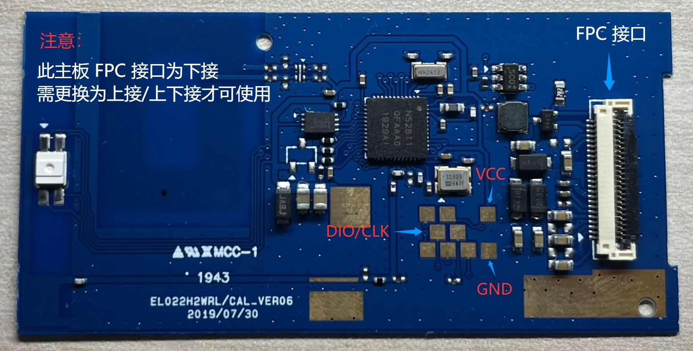

# nRF52811 Full programming and recovery

[中文](FLASHING.md) | English

For AESL/Hema EL022H2 marked EL022HWRL (CAL_VER06), target `nrf52811_aesl`. Obtain tools and firmware separately from the [distribution repository](https://github.com/solar2ain/ink-tag). Read the [target README](https://github.com/solar2ain/ink-tag/blob/main/firmware/nrf52811_aesl/README.en.md) and [shared guide](https://github.com/solar2ain/ink-tag/blob/main/docs/en/flash.md). Recovery1.0.1 installation requires an eligible Full package containing that version; actual downloads govern availability.

## Wiring and dependencies



Image from [EPD-nRF5](https://github.com/tsl0922/EPD-nRF5/blob/7e3196193997bd6a4644610c41d54a76eff88760/docs/devices.md), retaining upstream GPLv3. Confirm DIO/CLK signals rather than guessing left/right from the photograph.

| Board | J-Link |
| --- | --- |
| VCC | VTref |
| GND | GND |
| DIO | SWDIO |
| CLK | SWCLK |

Power the board with a suitably rated battery/supply. VTref senses target voltage; it is not power output. Never connect J-Link5V output to the tag. Current released tools support Windows x64/PowerShell5.1 or7, with J-Link7.88j and USB driver installed separately. Keep the entire plaintext tools directory and licenses. Portable Python/dependencies are supplied; system Python, CLI, SDK, compiler and WSL are unnecessary. Other macOS/DAPLink approaches are not current released entry points.

## Separate tools and firmware

Work in the distribution's `firmware/nrf52811_aesl/`: `tools/` contains tools, `full/` contains Full packages, `ota/` contains OTA. Firmware may also be stored elsewhere. Tools do not embed, automatically select or download firmware; probe/backup need none.

```powershell
powershell -NoProfile -ExecutionPolicy Bypass -File ".\tools\setup.ps1"
powershell -NoProfile -ExecutionPolicy Bypass -File ".\tools\check.ps1"
powershell -NoProfile -ExecutionPolicy Bypass -File ".\tools\flash.ps1" -Help
```

Replace the example `C:\InkTag\firmware\nrf52811-full.zip` with the actual downloaded and hash-checked Full package. See the target README for exact release filenames. Original panel: `EL022HWRL.toml`; A0 replacement: `EL022HWRL-A0.toml`.

```powershell
powershell -NoProfile -ExecutionPolicy Bypass -File ".\tools\flash.ps1" -Firmware "C:\InkTag\firmware\nrf52811-full.zip" -Config ".\tools\configs\EL022HWRL.toml" -RetryDetect -DryRun
powershell -NoProfile -ExecutionPolicy Bypass -File ".\tools\flash.ps1" -Firmware "C:\InkTag\firmware\nrf52811-full.zip" -Config ".\tools\configs\EL022HWRL.toml" -RetryDetect
```

DryRun validates offline without opening a probe. Real programming retains default y/N confirmation, native settings and complete independent readback.100% in one stage is not final success. RetryDetect retries initial detection only, never capture/programming/unknown results. Select `-JLinkSerial` for multiple probes. `-Yes` confirms the same scope; signature, identity, capacity and readback checks remain.

## Data scope and limits

Full initializes MCU firmware/native settings, replaces matched GUI resources, clears ordinary settings and old health/crash/reset requests, and invalidates image headers. Pixel data is not securely erased. FICR, UICR, valid factory identity, BLE address/type, calibration and reserved external sectors are preserved under existing tool rules. Full initialization differs from OTA anti-rollback; OTA verification remains unchanged.

A Full package includes matching SoftDevice, Recovery, App and GUI assets; do not mix arbitrary resource files. Backup is optional and separate; there is no automatic clock sync. See `backup.ps1 -Help`. Backup covers internal Flash/FICR/UICR, not external image Flash.

App OTA leaves Recovery, SoftDevice, GUI assets and layout unchanged. Recovery shares the App address with an `_OTA` name. Replacing Recovery requires an eligible Full package and wired installation.  Unsigned self-built BIN/HEX files are not eligible Full packages; do not rename them or bypass verification. See [build](../../../../docs/building.en.md).

## Self-built Full

The `-self-built-full.zip` from `python build.py` needs **tools0.2.1.0 or newer**. Its explicit container records the Recovery policy: optional permits unsigned App; required still needs a valid signature. Invalid supplied signatures always fail. The tool reports unauthenticated publishers while retaining integrity/target/capacity/layout/readback checks; `-Yes` never skips them. Existing official signed Full rules remain. See [one-command building](../../../../docs/building.en.md#10-build-a-complete-flashing-package).
