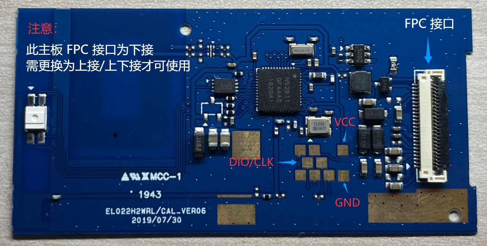

# nRF52811 完整烧录与恢复

中文 | [English](FLASHING.en.md)

适用于AESL／盒马EL022H2，丝印EL022HWRL（CAL_VER06），发布目标`nrf52811_aesl`。发行工具和固件从 [InkTag发布库](https://github.com/solar2ain/ink-tag)分别获取。先读[对应目标的最新说明](https://github.com/solar2ain/ink-tag/blob/main/firmware/nrf52811_aesl/README.md)和[统一烧录说明](https://github.com/solar2ain/ink-tag/blob/main/docs/zh-CN/flash.md)。Recovery1.0.1需使用包含该版本的合格Full包，实际可下载版本以发布附件为准。

## 接线与依赖



图片来自 [EPD-nRF5](https://github.com/tsl0922/EPD-nRF5/blob/7e3196193997bd6a4644610c41d54a76eff88760/docs/devices.md)，保留其GPLv3声明。按实际标注确认DIO／CLK，不能只凭照片左右推断。

| 主板 | J-Link |
| --- | --- |
| VCC | VTref |
| GND | GND |
| DIO | SWDIO |
| CLK | SWCLK |

主板由符合额定电压的电池或稳压电源供电。VTref是目标电压参考，不是供电输出；不把J-Link5V输出接到价签。当前发行流程支持Windows x64和PowerShell5.1／7，另装SEGGER J-Link7.88j及USB驱动。保留完整明文工具目录、相对依赖和许可；便携Python／依赖由tools-only目录提供，无需系统Python、CLI、SDK、编译器或WSL。macOS／DAPLink等其他方案不属于当前发行工具入口。

## 工具和固件分开

在发布库的`firmware/nrf52811_aesl/`目录操作。工具位于`tools/`，Full包位于`full/`（也可存放外部其他路径），OTA位于`ota/`。工具不内嵌、自动选择或下载固件；探测和备份不需要固件。

```powershell
powershell -NoProfile -ExecutionPolicy Bypass -File ".\tools\setup.ps1"
powershell -NoProfile -ExecutionPolicy Bypass -File ".\tools\check.ps1"
powershell -NoProfile -ExecutionPolicy Bypass -File ".\tools\flash.ps1" -Help
```

下面是参数结构示例，先把`C:\InkTag\firmware\nrf52811-full.zip`替换为实际下载并核对摘要的Full包；可直接复制的真实发行文件名见上方目标README。原屏用`EL022HWRL.toml`，换装A0用`EL022HWRL-A0.toml`，不得混用。

```powershell
powershell -NoProfile -ExecutionPolicy Bypass -File ".\tools\flash.ps1" -Firmware "C:\InkTag\firmware\nrf52811-full.zip" -Config ".\tools\configs\EL022HWRL.toml" -RetryDetect -DryRun
powershell -NoProfile -ExecutionPolicy Bypass -File ".\tools\flash.ps1" -Firmware "C:\InkTag\firmware\nrf52811-full.zip" -Config ".\tools\configs\EL022HWRL.toml" -RetryDetect
```

`-DryRun`仅离线校验包和配置，不接探针。实际烧录默认y/N确认、原生参数和完整独立回读；成功以全部阶段验证通过为准，100%不代表整体成功。`-RetryDetect`只重试最初检测，不重放擦写、捕获或结果未知的操作。多探针时显式`-JLinkSerial`；`-Yes`只确认原有清理范围，不跳过验签、身份、容量或回读。

## 数据范围与限制

Full重建MCU固件和原生设置，替换匹配GUI资源，清除普通设置及旧健康／崩溃／启动请求状态，使旧图片头失效；图片像素并非安全擦除。FICR、UICR、有效出厂身份、BLE地址／类型、校准和外置保留区按维护工具规则保留。Full与OTA的兼容epoch下限策略不同，不以旧损坏页作为新启动状态；OTA的验签和反回滚保持。

Full包包含配对SoftDevice、Recovery、App和GUI资源，不另写任意`font-assets.bin`。备份可先独立执行，工具不强制自动备份、不校时；需要时从`backup.ps1 -Help`选择准确板型。当前备份覆盖内部Flash、FICR、UICR，不包含外置图片Flash。

OTA只更新App，不更新Recovery、SoftDevice、GUI资源或布局。Recovery与App使用相同地址、不同`_OTA`名称。Recovery本身升级需合格Full包和有线流程；自编未签名BIN／HEX不是合格Full包，不改名或绕过签名检查，详见[编译说明](../../../../docs/building.md)。

## 源码自编 Full

`python build.py` 生成的 `-self-built-full.zip` 需要 **0.2.1.0 或更新工具**。该容器明确标记自编及 Recovery 策略：optional 可接收未签名 App，required 仍要求有效签名，有签名但验证失败的包始终拒绝。工具会提示发布者未认证，完整性／目标／容量／布局／回读检查不变；不会因为 `-Yes` 跳过它们。普通官方签名 Full 保持原规则。详见[一键构建](../../../../docs/building.md#10-一键生成完整刷机固件)。
